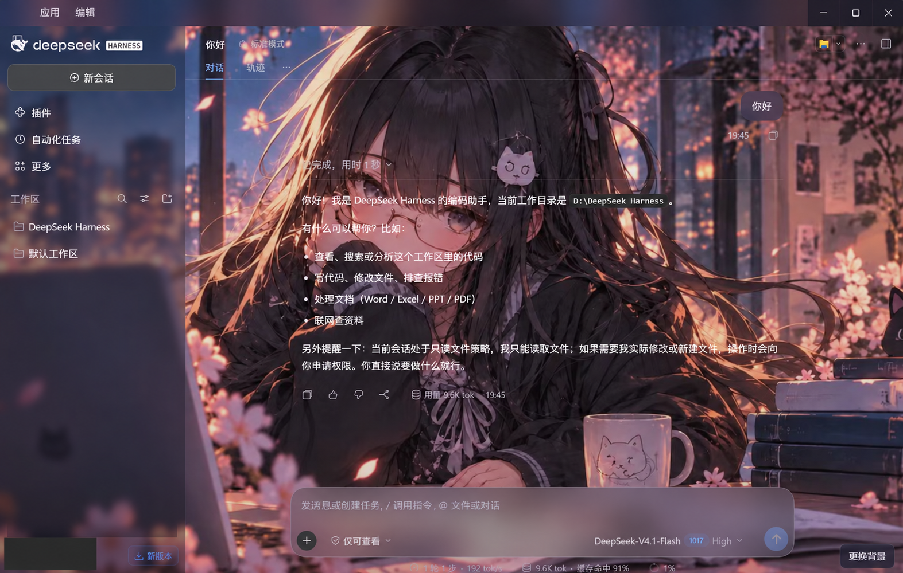

# 樱花夜读 · DeepSeek Harness Theme

一个可以自由更换 **DeepSeek Harness 背景**的社区插件。支持静态图片、动图，以及**时长不超过 4 秒的 MP4 / WebM 视频**；视频会静音循环播放，让你喜欢的画面成为聊天和工作的背景。

- **一键更换背景**：点击界面右下角「更换背景」，直接选择本地文件。
- **图片与动图**：支持 JPEG、PNG/APNG、GIF、WebP（含动态 WebP）。
- **短视频背景**：支持不超过 **4 秒**的视频，静音、自动循环，并自适应铺满窗口。
- **玻璃质感界面**：深色半透明侧栏与磨砂输入框，兼顾背景展示和文字阅读。
- **本地保存**：记住上次选择的背景；所选文件保存在本机，不会上传。
- **附带 skill**：方便 AI 代理帮助安装插件、替换背景或调整主题效果。

## 效果预览



*上图展示静态图片背景的成品效果，左下角头像和账户名已遮挡。也可以通过同一个「更换背景」按钮选择不超过 4 秒的视频作为动态背景。*

## 安装插件

在 DeepSeek Harness 中打开 **插件 → 添加插件**，输入：

```text
https://github.com/xietong-alt/dsh-sakura-study-theme
```

安装后启用 **樱花夜读**。仓库包含预构建的 `client.js`，使用默认背景无需自行构建，也没有依赖安装脚本。

如果 GitHub 拉取不便，可从本页 **Code → Download ZIP** 下载并解压，在「添加插件」中输入解压后含 `package.json` 的目录的绝对路径。

有官方 `dsh` CLI 时，也可先查看 `dsh plugin --help`，再用当前配置名称安装目录，例如桌面配置：

```text
dsh plugin --profile desktop add /absolute/path/to/dsh-sakura-study-theme
```

安装后检查插件管理器的应用状态。若需要重启，请从应用菜单或系统托盘正常退出后再打开；单击窗口关闭按钮可能只是让它转到后台。同名插件更新按当前 Harness 的卸载、更换流程处理。

关闭插件会移除它的样式和页面标记，恢复之前的外观。主题不读写会话、不访问账号或密钥，也不向外部图片服务发送请求；安装时的 GitHub/包管理器连接由 Harness 自身负责。

## 直接更换动态背景

启用后点击窗口右下角的 **更换背景**，选择本地文件：

| 类型 | 支持格式 | 行为 |
| --- | --- | --- |
| 图片与动图 | JPEG、PNG/APNG、GIF、WebP（含动态 WebP） | 保留原文件，动态格式直接播放 |
| 短视频 | MP4、WebM | 时长必须大于 0 且不超过 **4 秒**，静音、自动循环、铺满窗口 |

4.000 秒可用，4.001 秒会拒绝；超长视频不会替换当前背景，也不会被自动剪辑。MP4 建议使用 H.264，WebM 使用 VP8/VP9，实际解码取决于当前 Harness 内置浏览器。没有有效时长、没有视频轨道、无法解码或超过 32 MiB 的文件会给出错误提示。

选中的文件只保存在当前 Harness 浏览器的本机 IndexedDB 中，重新启动后会恢复；不会上传至 GitHub、服务器或模型。不同浏览器/配置的存储独立，清理应用数据会清除选择。点击 **恢复默认** 可回到随包插画。

窗口隐藏时暂停视频；系统启用「减少动态效果」时默认暂停视频，并把动图显示为静止帧。视频面板提供播放/暂停按钮。卸载播放器时会暂停视频、移除节点并释放临时文件 URL。

## 让 AI 帮你安装或调整

仓库附带独立 skill：[deepseek-harness-theme](skills/deepseek-harness-theme/SKILL.md)。它指导代理取得插件、使用指定图片构建、安装到实际 Harness，并检查背景发白等问题。

在支持 Codex skill 安装的环境中，可直接向代理发送：

```text
请安装这个 GitHub 仓库里的 skill：
https://github.com/xietong-alt/dsh-sakura-study-theme/tree/main/skills/deepseek-harness-theme
```

也可以将整个 `skills/deepseek-harness-theme` 文件夹复制到自己的 Codex skills 目录（通常为 `~/.codex/skills/`）。安装后调用：

```text
$deepseek-harness-theme 请把这张图片设为我的 Harness 背景，侧栏保持深色玻璃效果。
```

skill 与主题插件是两个独立部分：安装 skill 后，代理仍需要按你的请求安装或配置 Harness 插件。单独取得 skill 时，它会引导代理从本仓库获取源码，不依赖作者电脑上的路径。

## 换图片与调整效果

需要本地 Node.js 22 或更新版本，无第三方构建依赖。

修改 `theme.config.json` 后重新构建：

| 配置 | 默认值 | 作用 |
| --- | ---: | --- |
| `dimTop` / `dimBottom` | 0.05 / 0.12 | 顶部、底部的暗色衬底，0 为不加暗色 |
| `sidebarOpacity` | 0.38 | 侧栏深色玻璃的不透明度 |
| `sidebarBlur` | 5 | 侧栏模糊半径，单位 px |
| `composerOpacity` | 0.52 | 输入框深色玻璃的不透明度 |
| `composerBlur` | 20 | 输入框模糊半径，单位 px |

透明度范围为 0–1，模糊范围为 0–48 px。图片采用 `cover` 自适应窗口，宽高比不同时边缘会被裁切；不会改变原始图片字节。

```text
node scripts/build-theme.mjs
```

用自己的图片、动图或不超过 4 秒的视频生成独立可安装目录：

```text
node scripts/build-theme.mjs --media /absolute/path/to/background.mp4 --out /absolute/path/to/my-theme
```

`--image` 参数仍可使用。构建同时检查 MP4/WebM 容器声明的时长，拒绝超过 4 秒或时长未知的视频；播放器在导入时还会通过浏览器检查时长和解码能力。部分录屏生成的 WebM 不写时长，需要先导出为带有效时长的文件。

构建只写入指定目录，不自动安装或重启 Harness。媒体会内嵌到 `client.js`，不依赖图床；请编辑样式和配置源文件，不要手工修改 Base64。

## 兼容性与验证

默认样式在 **DeepSeek Harness 0.2.1-rc.3 / Windows** 的实际界面中验证过。动态媒体使用同一版本的 `shell.overlay` 扩展位置和布局容器。其他版本或平台尚未实机验证。布局类名属于版本相关实现；Harness 更新后如失效，请提交版本号及现象，维护者需要按当前布局适配。

主题在浅色外观下也应用深色调色板，不依赖一次性的外观切换；不改写用户保存的内置外观偏好。系统要求减少透明效果时，侧栏与输入框会使用更实的底色。

运行构建与生命周期测试：

```text
node --test tests/*.test.mjs
```

## 授权

代码、原创花朵图标与 skill 使用 [MIT License](LICENSE)。适配自 Harness 的深色调色板保留了 [DeepSeek 的 MIT 授权](THIRD_PARTY_LICENSES.txt)。背景插画的权利单独说明，见 [ASSET_LICENSE.md](ASSET_LICENSE.md)，不包含在代码的 MIT 授权中。

本项目是社区主题，与 DeepSeek 官方没有从属关系。
